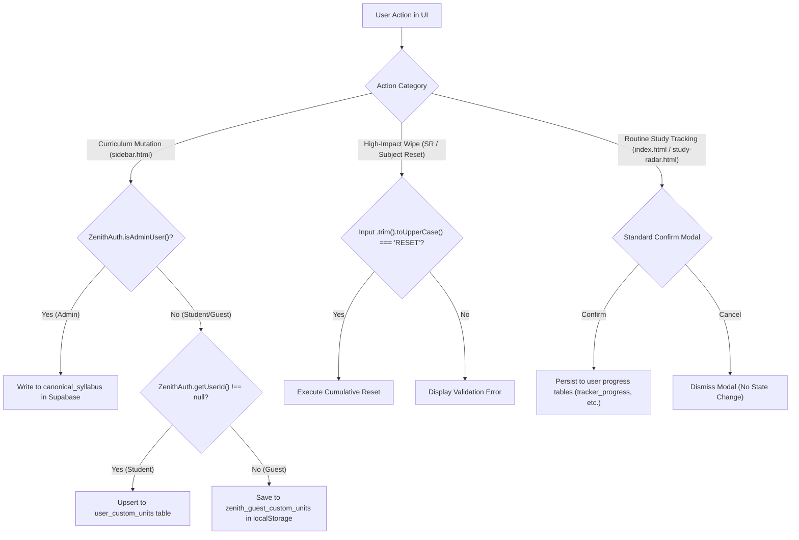

# Role-Based Authorization and Hardcoded PIN Retirement

*   **Author:** EGM Drafting Engine & Antigravity
*   **Status:** Approved
*   **Date:** 2026-11-02

--------------------------------------------------------------------------------

## Overview

This project transitions the Zenith / Wosandi Grade 9 Study Tracker from legacy static client-side PIN checks to a multi-tenant role-based authorization model. The core design ensures that platform master curriculum data (`canonical_syllabus`) is strictly restricted to verified platform administrators, while regular students and guests retain complete independence to customize their personal syllabus and track progress without repetitive, disruptive password barriers. Accidental historical data loss is prevented through typed confirmation words (`"RESET"`), while routine tracking actions utilize standard confirmation dialogs with explicit cancellation controls.

## The Problem

1. **False Security & Exposure of Secrets:** Legacy client-side PINs and print verification codes were embedded directly in client-side JavaScript, HTML source code, and error messages. Any user inspecting client assets could read them, providing no real security.
2. **Master Curriculum Vulnerability:** Canonical syllabus mutations in `sidebar.html` previously relied solely on knowledge of the shared PIN. Any student or guest who entered this number could modify or delete shared master units for all students.
3. **Severe Study Flow Interruption:** Routine, daily student actions (e.g., ticking homework done, logging a paper mark, marking a printed paper collected, or completing a spaced repetition stage) were repeatedly interrupted by password prompts, discouraging consistent daily tracking.
4. **Contractual Inconsistency:** Project documentation and EGM contracts mandated maintaining a static security PIN, conflicting with the multi-tenant role model established by `ZenithAuth`.

## Goals

*   **Eliminate Static Secrets:** Completely remove legacy hardcoded PIN and password checks across all application forms, modals, and JavaScript logic.
*   **Guaranteed Master Syllabus Protection:** Restrict all write operations (`INSERT`, `UPDATE`, `DELETE`) on `canonical_syllabus` strictly to authenticated administrators validated via `ZenithAuth.isAdminUser()`. Ensure zero code paths allow non-admin users to modify `canonical_syllabus`.
*   **Tenant-Scoped Customizations for Students and Guests:** Allow students and guests to add, edit, and toggle subjects and units freely, persisting changes exclusively to their tenant scope (`user_subjects_config`, `user_custom_units`, or guest local storage `zenith_guest_custom_units`).
*   **Deliberate Destruction Guards:** Safeguard cumulative historical resets (Spaced Repetition cycle reset and default subjects restoration) behind a typed phrase confirmation (`"RESET"`), normalized with `.trim().toUpperCase() === 'RESET'`, with clear bilingual Sinhala/English instructions.
*   **Frictionless Daily Tracking:** Provide standard confirmation modals with clearly visible affirmative and cancel buttons for routine tracking and individual record modifications (e.g., activity undo, deleting an exam record).
*   **Contract Alignment:** Update `GEMINI.md` and both EGM blueprint contracts to codify the role-based authorization model without recording secret values.

## Non-Goals

*   **No Schema Alterations:** Modifying database table definitions or altering Supabase column definitions (`user_custom_units` and `user_subjects_config` already exist in `schema_multitenant_zenith.sql`).
*   **No Disruption of 1-Level Hierarchy:** Changing the strict 1-level unit hierarchy rule (main units only, no sub-units).
*   **No Compulsory Login for Tracking:** Requiring account registration or login for daily study tracking; Guest Mode (`wosandi_legacy_user`) remains fully functional.
*   **No Complex Token/Session Architecture:** Introducing server-side session cookies or OAuth token refresh workflows beyond existing Supabase authentication.

## Open Questions

*   **Question 1**: How should unit conflict resolution behave when an administrator updates a unit in `canonical_syllabus` that a student has previously customized in `user_custom_units`? (Resolution: Student's personal customization takes precedence in their own view, leaving `canonical_syllabus` intact for others).

--------------------------------------------------------------------------------

## Critical User Journeys (CUJs)

### CUJ 1: Daily Student Study & Review Tracking
*   **Given**: An authenticated student or guest user is viewing the dashboard in `index.html` or `study-radar.html`.
*   **When**: The user clicks to complete a lesson or homework in the drilldown modal, logs a Unit Paper score, marks an urgent radar unit revised, or marks a printed test paper collected.
*   **Then**: The action executes immediately or presents a standard confirmation dialog with an explicit "Confirm" and "Cancel" button. No password or PIN prompt is displayed. The record is persisted and visual feedback is rendered.

### CUJ 2: Student Syllabus Customization
*   **Given**: An authenticated student (non-admin) or guest opens `sidebar.html` to add a new unit, edit a unit title, or remove a unit to match their school curriculum.
*   **When**: The student submits the "Add Unit", "Edit Unit", or "Delete Unit" action without entering any password.
*   **Then**: The application detects non-admin status (`ZenithAuth.isAdminUser() === false`). The modification or tombstone (`is_deleted = true`) is written to `user_custom_units` in Supabase (if authenticated) or `zenith_guest_custom_units` in `localStorage` (if guest). `canonical_syllabus` is never touched, and other users see no change to the master syllabus.

### CUJ 3: Platform Administrator Master Syllabus Update
*   **Given**: An administrator authenticated as the platform admin opens `sidebar.html`.
*   **When**: The administrator adds a new unit, edits a unit title, or deletes a unit.
*   **Then**: `ZenithAuth.isAdminUser()` evaluates to `true`. The change is committed directly to `canonical_syllabus` in Supabase and propagates to all students who have not overridden that unit.

### CUJ 4: High-Impact Reset (Spaced Repetition / Default Subjects)
*   **Given**: A user clicks the "Reset Spaced Repetition Cycle" button in `index.html` / `study-radar.html` or "Reset to Default Subjects" in `sidebar.html`.
*   **When**: The confirmation modal opens, instructing the user in Sinhala and English to type `"RESET"`.
*   **Then**: If the user types `"reset"`, `"RESET"`, or `" RESET "` (evaluated via `.trim().toUpperCase() === 'RESET'`), the reset executes. If any other input is submitted, the reset is blocked and a validation error is displayed.

--------------------------------------------------------------------------------

## Technical Plan (Architecture)

### 1. Authorization & Data Routing Architecture

The core architectural change decouples administrative curriculum authority from individual student syllabus tailoring, replacing static PIN matching with identity-based routing and explicit typed confirmations:



#### Admin Identity & Authorization Layers
`ZenithAuth` is defined and exported globally by `auth-manager.js` (`window.ZenithAuth`). The method `ZenithAuth.isAdminUser()` inspects the active authenticated Supabase session. It returns `true` if the session's verified email matches the platform administrator address (`ADMIN_EMAIL`, case-insensitively evaluated as `session.user.email.trim().toLowerCase() === ADMIN_EMAIL.toLowerCase()`) or if user metadata contains `role === 'admin'`. For unauthenticated sessions, expired sessions, and guest users, `isAdminUser()` evaluates to `false`.

**Defense-in-Depth Security Boundaries:**
*   *Application Layer:* Client scripts in `sidebar.html` route master vs custom mutations using `ZenithAuth.isAdminUser()`.
*   *Database Layer:* Supabase Row Level Security (RLS) policies defined in `schema_multitenant_zenith.sql` (e.g. `public.is_current_user_admin()`) reject unauthorized REST/PostgREST direct mutations on master tables.

#### Guest Detection Invariant
A guest session is identified strictly by checking:
```javascript
const isGuest = (typeof ZenithAuth !== 'undefined') 
  ? (ZenithAuth.getUserId() === null || ZenithAuth.getCurrentUser()?.isGuest === true)
  : true;
```
The application must **never** check whether `user.id` exists or is non-null to detect authenticated users, because guest sessions are assigned a mock user profile carrying the mock identifier `wosandi_legacy_user`.

#### Guest-to-Student Onboarding Migration Hook
When a guest student registers or signs in, `handleAuthenticatedUser()` in `auth-manager.js` executes an automated migration check:
1. If `localStorage.getItem('zenith_guest_custom_units')` exists and contains custom units, the payload is prepared by stripping any client-side temporary IDs and attaching the authenticated `user_id`.
2. The units are upserted into `user_custom_units` using the unique constraint `(user_id, subject, unit_number)`, allowing PostgreSQL's `DEFAULT gen_random_uuid()` to assign a valid UUID automatically.
3. The authenticated student's local cache key `ZenithAuth.getScopedKey('zenith_custom_units_cache')` is updated.
4. **Data Loss Guard:** `zenith_guest_custom_units` is cleanly purged from `localStorage` **only upon verified, successful confirmation** from the Supabase upsert. If the network request fails or the client is offline, the guest units remain preserved in local storage and queued for background synchronization.

### 2. Syllabus Loading & Merging Pipeline

When `sidebar.html`, `index.html`, or `study-radar.html` loads units:
1. **Master Base Query:** Fetch `canonical_syllabus` ordered by `sort_order`. (Note: `g9_canonical_units_cache` stores solely the read cache of base master units and is never used to store guest customizations).
2. **Tenant Overlay Query & Offline Caching:**
   - *Authenticated Student (`ZenithAuth.getUserId() !== null`):* Read immediately from local storage cache key `ZenithAuth.getScopedKey('zenith_custom_units_cache')`. If online, fetch from Supabase table `user_custom_units` where `user_id = ZenithAuth.getUserId()`, update the scoped local cache, and refresh view.
   - *Guest Student (`isGuest === true`):* Read custom units from dedicated `localStorage` key `zenith_guest_custom_units`.
3. **Data Schema for `zenith_guest_custom_units`:**
   In browser `localStorage`, guest custom units are uniquely keyed by `${subject}_${unit_number}` and stored as a serialized JSON array of unit record objects:
   ```json
   [
     {
       "subject": "MATH",
       "unit_number": 5,
       "unit_name": "ඒකකය 05: ත්‍රිකෝණමිතික අනුපාත",
       "sub_lesson_code": "Unit 05",
       "sub_lesson_title": "ත්‍රිකෝණමිතික අනුපාත",
       "is_deleted": false,
       "updated_at": "2026-11-02T15:00:00.000Z"
     }
   ]
   ```
4. **Merge & Lifecycle Algorithm:**
   - **Add Unit (`submitNewLesson`):** If admin, inserts into `canonical_syllabus`. If student/guest, checks if the composite key `${subject}_${unit_number}` already exists with `is_deleted === true`; if so, it un-tombstones the record (`is_deleted = false`) and updates the title. Otherwise, it upserts a new record to `user_custom_units` (or appends to `zenith_guest_custom_units`).
   - **Edit Unit (`submitEditLesson`):** If admin, updates `canonical_syllabus`. If authenticated student, upserts modified unit to `user_custom_units`. If guest, updates the matching element in `zenith_guest_custom_units`.
   - **Delete Unit (`deleteLesson`):** If admin, deletes the row directly from `canonical_syllabus`. If authenticated student, upserts a tombstone `{ is_deleted: true }` in `user_custom_units`. If guest, sets `{ is_deleted: true }` in `zenith_guest_custom_units`.
   - **Merge Output:** Map master units by composite key `${subject}_${unit_number}`. For each custom unit, if `is_deleted === true`, exclude from display list; otherwise, override matching master unit title or append as a custom unit.
   - **Foreign Key Safe Progress Tracking:** In `tracker_progress`, `syllabus_id` is nullable. When tracking progress for custom units without a canonical ID, `syllabus_id` is set to `NULL`, and the record is identified and queried via `(user_id, subject, sub_lesson_code)`. Local IndexedDB caches key progress records by `${subject}_${sub_lesson_code}`, guaranteeing zero foreign key violations.
   - Sort by unit number and render.

### 3. Component Modifications and Code Touchpoints

#### A. `sidebar.html` (Syllabus & Subject Management)
*   **DOM Removals:**
    - Remove `<input id="addPassword">` and `<div id="addPasswordError">`.
    - Remove `<input id="editPassword">` and `<div id="editPasswordError">`.
    - Remove `<input id="subjPassword">` and `<div id="subjPasswordError">`.
*   **Function Refactoring:**
    - Remove `promptPin()` entirely.
    - `submitNewLesson()`: Remove PIN check. If `ZenithAuth.isAdminUser()` is true, write to `canonical_syllabus`; otherwise, persist unit to `user_custom_units` and `ZenithAuth.getScopedKey('zenith_custom_units_cache')` (authenticated) or `zenith_guest_custom_units` in `localStorage` (guest).
    - `submitEditLesson()`: Remove PIN check. If `ZenithAuth.isAdminUser()` is true, update `canonical_syllabus`; otherwise, upsert modified unit to `user_custom_units` (authenticated) or `zenith_guest_custom_units` in `localStorage` (guest).
    - `deleteLesson()`: Add delete handler. If `ZenithAuth.isAdminUser()` is true, delete from `canonical_syllabus`; otherwise, record `{ is_deleted: true }` in `user_custom_units` or `zenith_guest_custom_units`.
    - `toggleSubjectActive()`, `deleteSubject()`: Remove `promptPin()`. Subject changes persist to `user_subjects_config` (authenticated) or `localStorage` (guest) via `saveSubjects()`.
    - `resetSubjectsToDefault()`: Replace `promptPin()` with a typed `"RESET"` confirmation prompt requiring the user to type `"RESET"` (evaluated via `.trim().toUpperCase() === 'RESET'`) before restoring the 13 default subjects.

#### B. `index.html` (Main Dashboard PWA)
*   **DOM Removals:**
    - Remove `#printPaperPasswordInput` from `#printPaperConfirmPopup`.
    - Remove `#fpPasswordInput` from `#fullPaperModal`.
    - Remove `#upPasswordInput` from `#confirmDialogModal`.
    - Remove `#fupPasswordInput` from `#fullUnitPaperModal`.
    - Remove `#ebbPasswordInput` from `#ebbConfirmPopup`.
    - Remove `#undoPasswordInput` from `#undoConfirmModal`.
    - Remove `#urgentRadarPasswordInput` from `#urgentRadarConfirmPopup`.
    - Remove `#subLessonPasswordInput` and `#subLessonPasswordError` from `#subLessonConfirmPopup`.
*   **Constant & Function Refactoring:**
    - Delete `PRINT_PAPER_PASSWORD` constant.
    - In `confirmPrintPaperDone()`, execute print state update immediately on affirmative click.
    - In `submitFullPaper()`, `executeConfirmedUnitPaper()`, `submitFullUnitPaper()`, `confirmEbbDone()`, `executeUndoConfirmed()`, `confirmUrgentRadarDone()`, and `executeSubLessonConfirmed()`: remove password checks and execute upon user confirmation.
    - In `executeResetRepetitionConfirmed()`: Repurpose `#resetRepetitionPasswordInput` into a text input with standardized placeholder `"තහවුරු කිරීමට RESET ලෙස ටයිප් කරන්න / Type RESET to confirm"`. Validate `if (inputVal.trim().toUpperCase() !== 'RESET')`.

#### C. `study-radar.html` (Study Radar PWA)
*   **DOM Removals:**
    - Remove `#fpPasswordInput` and `#fpPasswordError` from Full Paper modal.
    - Remove `#upPasswordInput` and `#upPasswordError` from Unit Paper modal.
    - Remove `#urgentRadarPasswordInput` and `#urgentRadarPasswordError` from Urgent Radar modal.
    - Remove `#ebbPasswordInput` and `#ebbPasswordError` from Spaced Repetition Done modal.
    - Repurpose `#resetRepetitionPasswordInput` into a text input with standardized placeholder `"තහවුරු කිරීමට RESET ලෙස ටයිප් කරන්න / Type RESET to confirm"`.
*   **Function Refactoring:**
    - In `submitFullPaper()`, `executeConfirmedUnitPaper()`, `confirmUrgentRadarDone()`, and `confirmEbbDone()`: remove password validation and execute upon user confirmation.
    - In `executeResetRepetitionConfirmed()`: validate `if (inputVal.trim().toUpperCase() !== 'RESET')`.

#### D. `study-analytics.html` (Analytics)
*   **DOM & Helper Removal:**
    - Repurpose `#securityPinModal` into an in-page modal dialog `#deleteSessionConfirmModal` with explicit affirmative ("ඔව්, ඉවත් කරන්න") and cancellation ("අවලංගුයි") buttons.
    - Delete `confirmPinModal()` and `requestPinVerification()`.
    - In `submitManualSession()`: remove PIN verification requirement.
    - In `deleteSession()`: display `#deleteSessionConfirmModal`; upon affirmative confirmation, delete session from local cache and Supabase without PIN entry.

#### E. Project Rules & Documentation
*   Update `GEMINI.md`: Replace rule 1 with Role-Based Authorization rule.
*   Update `README.md` and `html index sidebar both/README.md`: Document admin vs student syllabus boundaries, typed `"RESET"` requirement, and standard confirmations without secret values.

--------------------------------------------------------------------------------

## Alternatives Considered

### Alternative A: Restricting Students & Guests to Read-Only View of Syllabus

*   **Pros**: 
    - Eliminates any risk of syllabus mutation by non-administrative users.
    - Simplifies `sidebar.html` logic by disabling editing forms completely for non-admins.
*   **Cons**: 
    - Completely locks students out of adjusting unit titles or adding missing units for custom school curricula or provincial variations.
    - Frustrates motivated learners who need the study tracker to mirror their actual classroom sequence.
*   **Reason for Rejection**: 
    - Discarded in favor of tenant-scoped overlays. Persisting user customizations to `user_custom_units` (or guest local storage `zenith_guest_custom_units`) provides complete personal freedom while keeping `canonical_syllabus` 100% read-only and uncorrupted for all other students.

### Alternative B: Retaining PIN as a Configurable Parental Control Setting

*   **Pros**: 
    - Allows parents or tutors to set a custom PIN if they wish to restrict their child from making accidental modifications.
*   **Cons**: 
    - Introduces significant state management, password recovery flows, and cross-device sync complexity in a lightweight PWA.
    - Re-establishes daily cognitive friction on single-user student devices.
    - Client-side PINs in unminified web code provide no cryptographic protection.
*   **Reason for Rejection**: 
    - The complexity and friction far outweigh any marginal parental control benefit. True multi-tenancy and role checks via `ZenithAuth` provide the correct architectural boundary.

### Alternative C: Using Native `window.confirm()` for All Destructive Actions

*   **Pros**: 
    - Zero custom HTML dialog markup, styling, or text validation inputs required.
    - Minimal code footprint.
*   **Cons**: 
    - Native browser `confirm()` dialogs are frequently clicked past via unconscious muscle memory or accidental screen taps on mobile devices.
    - Tapping "OK" accidentally on a cumulative action like resetting Spaced Repetition wipes weeks of historical review intervals irreversibly.
*   **Reason for Rejection**: 
    - High-consequence cumulative wipes require deliberate, focused intent. Requiring the user to type the word `"RESET"` (normalized via `.trim().toUpperCase()`) guarantees conscious consent and prevents accidental mobile misfires.

--------------------------------------------------------------------------------

## Non-Functional Requirements

### Security & Authorization
*   **Master Data Integrity**: Direct SQL mutations on `canonical_syllabus` (`INSERT`, `UPDATE`, `DELETE`) are strictly forbidden unless `ZenithAuth.isAdminUser()` returns `true`.
*   **No Static Secrets in Source Code**: No hardcoded passwords, PINs, or backdoor codes may exist anywhere in JavaScript, HTML, CSS, or documentation.
*   **Tenant Data Isolation**: User customizations must be scoped strictly by `user_id` in Supabase (`user_custom_units`, `user_subjects_config`) or by guest-isolated local storage keys (`zenith_guest_custom_units`), preventing cross-tenant leakage.

### Usability & Accessibility
*   **Mobile Touch Ergonomics**: Standard confirmation dialogs must present large, visually distinct affirmative and cancel buttons with sufficient touch padding to prevent accidental misclicks.
*   **Bilingual Sinhala/English Guidance**: The typed `"RESET"` confirmation must display clear dual-language explanations indicating the permanent nature of the action and the exact string to type.
*   **Input Normalization**: The typed input validation must normalize string comparisons using `.trim().toUpperCase() === 'RESET'` to avoid false rejections caused by mobile keyboard auto-capitalization or leading/trailing whitespace.

### Offline & Resilience
*   **Zero Network Dependency for Student Actions**: All routine student tracking, custom unit saving in guest mode, client caching via `ZenithAuth.getScopedKey('zenith_custom_units_cache')`, and offline queueing in IndexedDB must continue operating without requiring online administrator verification.

--------------------------------------------------------------------------------

## Detailed Implementation Plan

### Target Files to Create/Modify

#### 1. `GEMINI.md` (Modify)
*   **Type / Scope**: Workspace Architectural Rules & Directives.
*   **Proposed Changes**:
    - Under Section 1, replace rule `- **Security PIN**: Maintain password ... for all protected write/edit actions` with:
      > `- **Role-Based Authorization & Zero Static PINs**: All hardcoded PINs and passwords are retired. Mutations to canonical_syllabus in sidebar.html are strictly restricted to verified administrators (ZenithAuth.isAdminUser()). Students and guests may customize subjects and units freely, persisted exclusively to their own tenant scope (user_subjects_config, user_custom_units, or local storage). Routine tracking actions use standard confirmation dialogs with cancel buttons. High-impact cumulative resets (Spaced Repetition engine and default subjects) require typing the confirmation phrase "RESET" (normalized via .trim().toUpperCase() === 'RESET').`
    - Under Section 2, update the dynamic subject configuration rule to state that subject customizations by regular users save to their personal config, while canonical subject defaults can only be changed by verified administrators.

#### 2. `README.md` (Modify)
*   **Type / Scope**: Repository Root Blueprint Contract.
*   **Proposed Changes**:
    - Under `## Local Interface & Invariants` and `## Global Invariants`: Remove references to legacy static PINs.
    - Document the authorization boundary: `ZenithAuth.isAdminUser()` guards `canonical_syllabus`, while regular users and guests save customizations to `user_custom_units` and `user_subjects_config`.
    - Document the typed `"RESET"` requirement for Spaced Repetition engine cycle resets and default subject restoration.

#### 3. `html index sidebar both/README.md` (Modify)
*   **Type / Scope**: Presentation Component Package Contract.
*   **Proposed Changes**:
    - Under `## Invariants`: Remove invariant referencing the security PIN.
    - Add role-based syllabus mutation invariants (`canonical_syllabus` write access restricted to `ZenithAuth.isAdminUser()`), user-scoped customization invariants, and typed `"RESET"` validation invariants.

#### 4. `html index sidebar both/sidebar.html` (Modify)
*   **Type / Scope**: Syllabus and Subject Management PWA Page.
*   **Proposed Changes**:
    - Remove HTML password form groups: `#addPassword`, `#addPasswordError`, `#editPassword`, `#editPasswordError`, `#subjPassword`, and `#subjPasswordError`.
    - Delete `promptPin()` JavaScript function.
    - In `submitSubjectForm(e)`: Remove `#subjPassword` read and validation check. Check `ZenithAuth.isAdminUser()`. If true, update master config; if student or guest, save to user/guest scoped storage (`user_subjects_config` / `localStorage`).
    - In `cancelEditSubject()`: Remove assignment setting `#subjPassword.value = ''`.
    - In `toggleSubjectActive(code)` and `deleteSubject(code)`: Remove `promptPin()` check; replace with standard confirmation dialog if needed and persist change per user tenant scope.
    - In `submitNewLesson()`: Remove PIN check. Check `ZenithAuth.isAdminUser()`. If true, execute `supabase.from('canonical_syllabus').insert([payload])`. If false, execute upsert to `user_custom_units` (or guest storage) and update `ZenithAuth.getScopedKey('zenith_custom_units_cache')`. Handle un-tombstoning if previously deleted.
    - In `submitEditLesson()`: Remove PIN check. Check `ZenithAuth.isAdminUser()`. If true, update `canonical_syllabus`. If false, upsert modified unit to `user_custom_units` (or guest storage).
    - In `deleteLesson()`: Add delete handler and inject a delete trigger button (`🗑️ මකන්න`) into `.res-actions` within search results and `#editForm`. If admin, delete from `canonical_syllabus`. If non-admin student, upsert `{ is_deleted: true }` to `user_custom_units`. If guest, record `{ is_deleted: true }` in `zenith_guest_custom_units`.
    - In `loadSyllabus()`: After fetching `canonical_syllabus`, fetch active user's `user_custom_units` from local cache `ZenithAuth.getScopedKey('zenith_custom_units_cache')`, overlaying customized unit titles and omitting marked-as-deleted units before rendering.
    - In `resetSubjectsToDefault()`: Replace `promptPin()` with prompt requiring typed `"RESET"` (evaluated via `.trim().toUpperCase() === 'RESET'`).

#### 5. `html index sidebar both/index.html` (Modify)
*   **Type / Scope**: Main Dashboard PWA Interface.
*   **Proposed Changes**:
    - Remove constant `PRINT_PAPER_PASSWORD`.
    - Remove password input DOM fields and their corresponding error containers:
      - `#printPaperPasswordInput` and `#printPaperPasswordError` from `#printPaperConfirmPopup`.
      - `#fpPasswordInput` and `#fpPasswordError` from `#fullPaperModal`.
      - `#upPasswordInput` and `#upPasswordError` from `#upConfirmCard` (inside `#unitPaperModal`).
      - `#fupPasswordInput` and `#fupPasswordError` from `#fullUnitPaperModal`.
      - `#ebbPasswordInput` and `#ebbPasswordError` from `#ebbConfirmPopup`.
      - `#undoPasswordInput` and `#undoPasswordError` from `#undoConfirmPopup`.
      - `#urgentRadarPasswordInput` and `#urgentRadarPasswordError` from `#urgentRadarConfirmPopup`.
      - `#subLessonPasswordInput` and `#subLessonPasswordError` from `#subLessonConfirmPopup`.
      - `#resetRepetitionPasswordError` from Spaced Repetition reset UI.
    - In functions `confirmPrintPaperDone()`, `submitFullPaper()`, `executeConfirmedUnitPaper()`, `submitFullUnitPaper()`, `confirmEbbDone()`, `executeUndoConfirmed()`, `confirmUrgentRadarDone()`, and `executeSubLessonConfirmed()`: remove password checks and execute upon user confirmation.
    - In `executeResetRepetitionConfirmed()`: Change input placeholder to `"තහවුරු කිරීමට RESET ලෙස ටයිප් කරන්න / Type RESET to confirm"`. Validate `inputVal.trim().toUpperCase() === 'RESET'`.
    - In syllabus data fetching, ensure `user_custom_units` (from `ZenithAuth.getScopedKey('zenith_custom_units_cache')`) overlays on `canonical_syllabus` for the current user.

#### 6. `html index sidebar both/study-analytics.html` (Modify)
*   **Type / Scope**: Analytics and Telemetry Visualization UI.
*   **Proposed Changes**:
    - Repurpose `#securityPinModal` into an in-page modal dialog `#deleteSessionConfirmModal` with explicit affirmative ("ඔව්, ඉවත් කරන්න") and cancellation ("අවලංගුයි") buttons.
    - Remove functions `confirmPinModal()` and `requestPinVerification()`.
    - Clean up `window` exports (`window.confirmPinModal`, `window.cancelPinModal`, `window.closePinModal`, `window.requestPinVerification`) and update the document-level `keydown` event listener to bind `Enter`/`Escape` to `#deleteSessionConfirmModal`.
    - In `saveManualSession()`: remove PIN verification requirement.
    - In `deleteSession()`: display `#deleteSessionConfirmModal`; upon affirmative confirmation, delete session from local cache and Supabase without PIN entry.

#### 7. `html index sidebar both/study-radar.html` (Modify)
*   **Type / Scope**: Study Radar PWA Interface.
*   **Proposed Changes**:
    - Remove password input DOM fields:
      - `#fpPasswordInput` and `#fpPasswordError` from Full Paper modal.
      - `#upPasswordInput` and `#upPasswordError` from Unit Paper modal.
      - `#urgentRadarPasswordInput` and `#urgentRadarPasswordError` from Urgent Radar modal.
      - `#ebbPasswordInput` and `#ebbPasswordError` from Spaced Repetition Done modal.
    - In `submitFullPaper()`: Remove `#fpPasswordInput` from form markup (no JavaScript verification was present).
    - In `confirmUrgentRadarDone()` and `confirmEbbDone()`: Remove password checks and execute upon affirmative confirmation.
    - For repetition reset and unit paper modals: Wire confirmation directly to reset/log routines (with typed `"RESET"` validation via `.trim().toUpperCase() === 'RESET'` for cycle resets), or eliminate orphaned modal markup.
    - In syllabus loading, ensure `user_custom_units` (from `ZenithAuth.getScopedKey('zenith_custom_units_cache')`) overlays on `canonical_syllabus`.

### Verification Plan

*   **Syntax & Static Integrity**:
    - Verify all HTML files parse without unclosed tags or broken inline script blocks.
    - Run regex search across all files to confirm zero occurrences of legacy static PIN strings and legacy password inputs (`#addPassword`, `#editPassword`, `#subjPassword`, `#fpPasswordInput`, `#upPasswordInput`, `#fupPasswordInput`, `#ebbPasswordInput`, `#undoPasswordInput`, `#urgentRadarPasswordInput`, `#subLessonPasswordInput`).
*   **Local Server Execution**:
    - Run `node server.js` to ensure static server and `/env.js` start without error.
*   **Manual End-to-End Verification Scenarios**:
    1. *Student Tracking*: As a guest / regular student in `index.html` and `study-radar.html`, tick Lesson Done (`#subLessonConfirmPopup`), Homework Done, Unit Paper score, and print paper status. Verify zero password dialogs appear.
    2. *Spaced Repetition Reset*: Click reset repetition in `index.html` and `study-radar.html`. Type lowercase `"reset"`, mixed `"ReSeT"`, and `"RESET"`. Verify all variations succeed. Type `"1234"` or click submit empty; verify action is blocked with error message.
    3. *Student Custom Unit*: In `sidebar.html` as regular student / guest, add a custom unit or delete a unit. Verify it persists to `user_custom_units` (or `zenith_guest_custom_units`), reflects in their syllabus, and `canonical_syllabus` remains unmodified.
    4. *Admin Master Unit*: In `sidebar.html` logged in as platform admin, edit or delete a unit. Verify `canonical_syllabus` in Supabase updates and propagates.
    5. *Analytics Session Delete*: In `study-analytics.html`, delete a logged study session. Verify in-page modal dialog `#deleteSessionConfirmModal` appears without PIN prompt.

--------------------------------------------------------------------------------

*Drafted with EGM*
